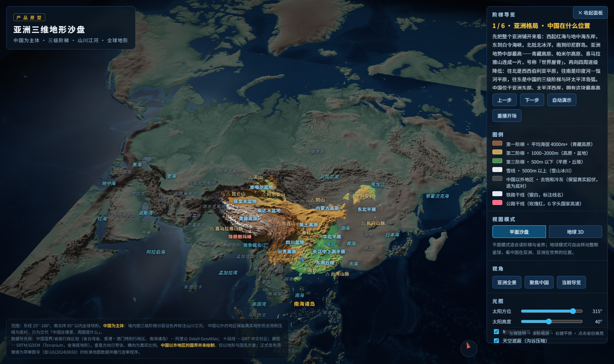
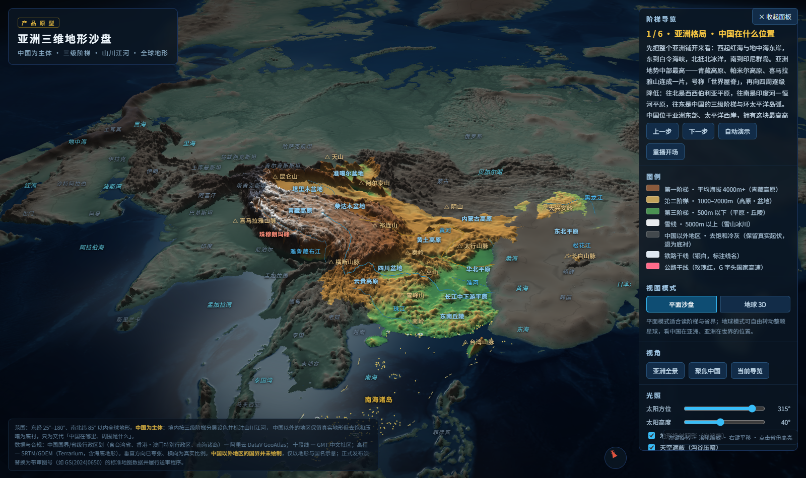
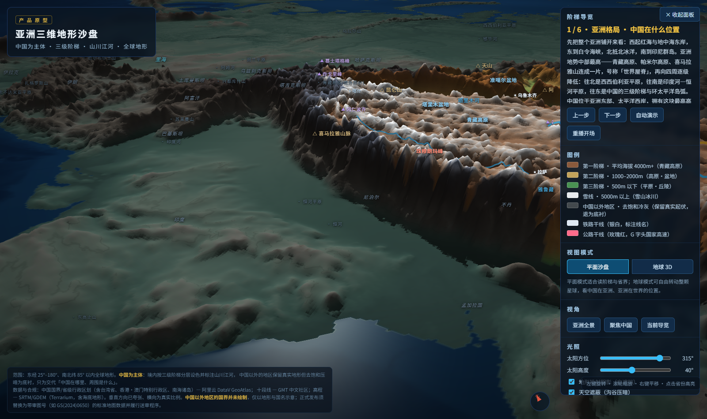
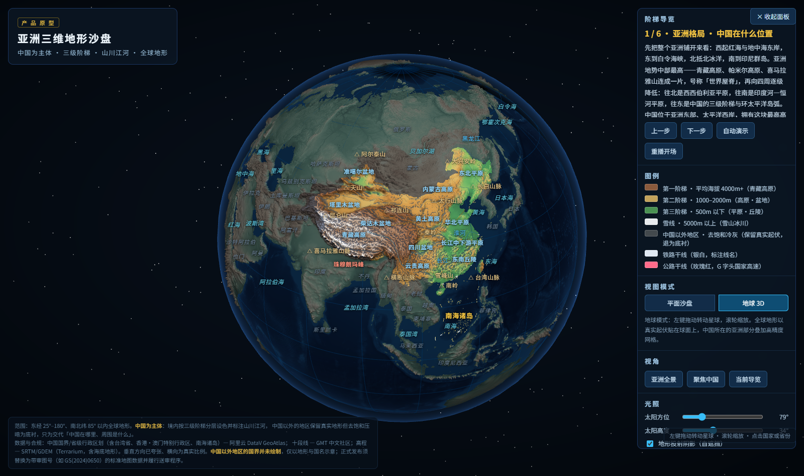

# TerraAsia · 亚洲三维地形沙盘

把「亚洲地形格局 + 中国地势三级阶梯」做成可旋转、可讲、可演示的三维地理沙盘。
渲染范围覆盖整个亚洲（东经 25°–180°、北纬 11°S–80°N），**中国是唯一的视觉主体**——境内保留分层设色与全部标注，境外去饱和压暗为冷灰浮雕，只做地理参照。



## 这是什么

一个 WebGL 地形可视化产品，**Vite + React + TypeScript + react-three-fiber** 构建，产物是一个纯静态站点（`index.html` + `assets/` + `data/`），由 nginx 托管。
地形不是贴图，是用真实 SRTM/GDEM 高程撑起来的三维网格——**两级精度共存**：全球 1024×1024 粗网格铺满整颗星球，亚洲 1536×1493 高精网格压在它上面。

面向三类场景：中学地理课堂投屏、科普内容生产（录屏素材）、政企展厅/沙盘演示。

| 中国全境 | 喜马拉雅—印度一侧 | 地球模式 |
|---|---|---|
|  |  |  |

## 能力

- **地形光照**：太阳方位/高度可调，实时计算**高度场自遮挡**（山体把阴影投到沟谷与背风坡），叠加预计算**天空遮蔽**（AO），高海拔按坡度区分裸岩与积雪
- **平面 / 地球双模式**：一个 `uGlobe` 系数把整张地形（连同国界、河流、交通、标注）连续卷到球面；地球模式铺**完整世界地图**，配晨昏线、经纬网、大气辉光与星空，两种模式平滑过渡
- **两级精度**：全球 z4 粗网格 + 亚洲 z6 高精网格同时存在，靠 `polygonOffset` 与边缘羽化融为一体，不做 LOD 切换、缩放时不会跳精度
- **三级阶梯叙事**：6 步分步导览（亚洲格局 → 中国总览 → 一/二/三阶梯 → 江河东流），每步 = 镜头飞抵 + 目标阶梯高亮（其余压暗至 30–42%）+ 讲解文案
- **点选省份**：射线拾取地形反算经纬度 → 点在面判定 → 高亮该省 + 展开该省地级市界与市名（33 省 / 446 个市级单元），信息卡给出平均海拔、主体阶梯、省会
- **标注四级 LOD + 屏幕空间避让**：远景只留大地貌，放大逐级"长出"省会 → 重点城市 → 名山景区；同屏按优先级占位，撞车先挪一行、挪不开才让位，远景优先读阶梯、近景优先读城市
- **13 个独立图层开关**：山脉 / 地形区 / 河流水体 / 城市 / 山峰景区 / 亚洲国家名 / 境外山河名 / 省界 / 地级市界 / 铁路 / 公路 / 阶梯分界线 / 十段线
- **立体感实时可调**：1–16× 垂直夸张，河湖、阶梯线、省界、市界、交通、标注随地形重新贴附
- 水面菲涅尔反射与太阳反光带、海岸泡沫、每 500m 等高带、开场逐级升起、河流流动光点、阶梯分界光带、指北针、自动旋转

## 快速开始

```bash
npm ci                            # 前端依赖
pip install -r requirements.txt   # numpy / Pillow / requests

npm run build                     # 完整链路，首次会下载 1012 张 DEM 瓦片（约 55MB）
npm run check                     # 无头渲染校验 + 截图
node scripts/check-func.js        # 功能回归：点选/双模式/图层/夸张/导览
```

开发时用 `npm run dev`（Vite HMR，端口 5173）。

产物在 `dist/`：

```
dist/
├── index.html          0.7 KB   薄壳
├── assets/             ~1 MB    three / r3f / 应用三个 chunk（gzip 294 KB）
└── data/               3.5 MB   terrain.webp · mask.webp · data.json · world.webp · world_mask.webp
```

数据图是无损 WebP 而不是 PNG：同样的像素，体积小 30%（4.8 MB → 3.5 MB）。这两张图
里 R,G 两个字节拼成 16 位高程，属于**数据**不是照片，所以只能用 lossless —— 实测有损
压缩会让 26% 的像素在「境内/境外」判定上翻转。

| 命令 | 作用 |
|---|---|
| `npm run build` | 数据管线 + `tsc --noEmit` + `vite build`，一条链路出站点 |
| `npm run dev` | Vite 开发服务器（热更新） |
| `npm run app` | 只跑 `tsc --noEmit && vite build`（数据没变时用） |
| `npm run verify` | 产物校验（`dist/` 结构、体积、图片尺寸与 meta 自洽、着色器标记），CI 门禁 |
| `npm run check` | 无头浏览器打开并截图，抓 pageerror / 404，校验标注零重叠 |
| `npm run shots` | 六个状态的定标截图 |
| `npm run cities` | 重抓地级市界（换行政区划数据时才需要） |

> Python 环境用 `python`。若本机默认解释器缺 numpy，用 `PYTHON=/path/to/python npm run build` 指定。

## 目录

```
TerraAsia/
├── app/                  前端（Vite root）
│   ├── index.html        唯一入口
│   ├── public/data/      管线产出的运行时数据（不入库）
│   └── src/
│       ├── data/         投影 / 球面映射 / 数据加载 / 静态数据 / 导览机位（不碰 React）
│       ├── scene/        地形网格与着色、矢量与流线图层、标注、相机与拾取
│       ├── ui/           侧面板与 HUD（纯 React）
│       └── state/        zustand：只放离散 UI 状态
├── src/pipeline/         Python 数据管线（config.py 是路径唯一来源）
├── archive/v0.6-web/     单文件时代的 13 模块前端（只读留档）
├── scripts/              无头校验 / 功能回归 / 定标截图
├── tests/                产物校验（CI 门禁）
├── deploy/               nginx 配置 + 服务器初始化脚本
├── data/
│   ├── source/           权威输入（入库）：国界、省界、十段线
│   ├── datasets/         脚本生成但入库：cities.json
│   └── cache/            可重下的缓存（不入库）：DEM 瓦片、地级市原始 JSON
├── build/ dist/          中间产物与交付物（不入库）
└── docs/                 产品说明 / 开发规范 / 部署运维 / 外部参考
```

## 数据管线

| 步骤 | 命令 | 产出 |
|---|---|---|
| 1 | `npm run data` | `build/data.json`：1536×1493 高度场编码成 RGBA PNG（R,G=16 位高程；B=阶梯档位／水深；A=陆地掩膜）+ 国界/省界/十段线/河流/阶梯分界折线 |
| 2 | `npm run mask` | `build/data.split.json`：把 A 通道拆成独立灰度 PNG（否则 canvas 预乘 alpha 会清掉 A=0 像素的 RGB） |
| 3 | `npm run publish` | `app/public/data/`：`terrain.webp` / `mask.webp`（无损 WebP）/ `data.json`（不含图片） |
| 4 | `npm run world` | `app/public/data/`：z4 瓦片 → 1024×1024 `world.webp` / `world_mask.webp` / `world.json` |
| 5 | `npm run app` | `dist/`：`tsc --noEmit` + `vite build` |
| — | `npm run cities` | `data/datasets/cities.json`（已入库，仅换行政区划数据时需要重跑） |

数据来源：高程 AWS Terrarium（SRTM/GDEM，亚洲 z6 / 全球 z4）；国界/省界/地级市界 阿里云 DataV GeoAtlas；十段线 gmt-china。

## 部署

`main` 每次 push 由 GitHub Actions 自动构建、校验并发布（构建 → 产物校验 → 上传 → 原子切换）。

服务器初始化、密钥与仓库变量配置、发布与回滚、排障，全部见 **[docs/03-部署运维.md](docs/03-部署运维.md)**。

## 文档

| 文档 | 内容 |
|---|---|
| [01-产品说明](docs/01-产品说明.md) | 产品定位、交互设计、视觉与数据方案、双网格取舍、肤色编码、踩坑记录 |
| [02-开发规范](docs/02-开发规范.md) | 目录职责、分层约束、命名、代码风格、数据资产边界、Git 规范 |
| [03-部署运维](docs/03-部署运维.md) | 服务器初始化、密钥配置、发布与回滚、排障 |
| [04-外部参考与资源](docs/04-外部参考与资源.md) | 可复用的公开数据与外部工程方案，以及明确不借的部分 |

## 合规（重要）

中国国界、省级行政区划、地级市界、十段线均使用标准数据，含台湾省、香港/澳门特别行政区、南海诸岛，未做简化删改；**中国以外地区不绘制国界**，仅以地形与国名示意。

本工程是**产品原型**。任何对外发布／商用前必须替换为带审图号的标准地图服务数据（如天地图 GS(2024)0650），并按《地图管理条例》履行送审程序。

## 已知限制

- 中国境内网格仍是 0.10°/px，省域近景的地形细节受限；下一步按省载入 z7–z8 分块
- 河流、铁路、公路为**教学示意**数据，非精确走向
- 境外只有地形与地名，没有国界、城市、水系
- 移动端未做网格降档与手势适配

## Roadmap

| 优先级 | 事项 |
|---|---|
| P0 | 河流/铁路/公路换权威矢量；审图号数据替换 + 送审 |
| P1 | 省域高精度下钻（DEM z7–z8 分块）；境外矢量（Natural Earth / OSM）接入 |
| P1 | 剖面/测距工具：任意两点取高程剖面，直观看到阶梯落差 |
| P2 | 卫星影像／夜光城市贴图模式；内置旁白 + 一键导出分步动图；移动端手势 |

## 许可

内部项目，未授权公开分发。
