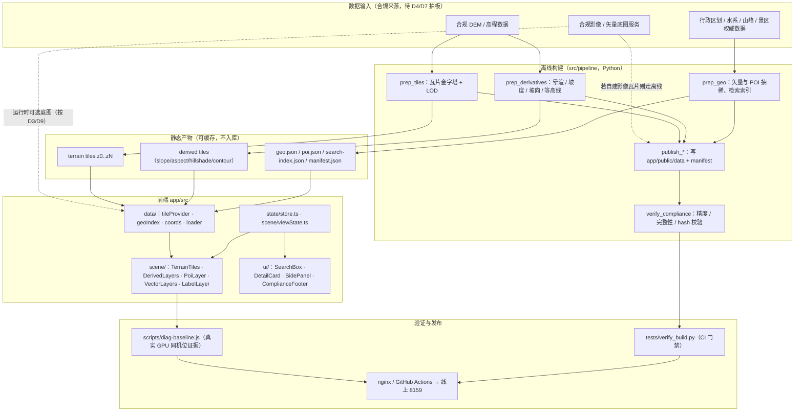
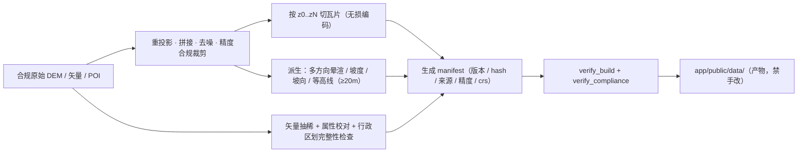
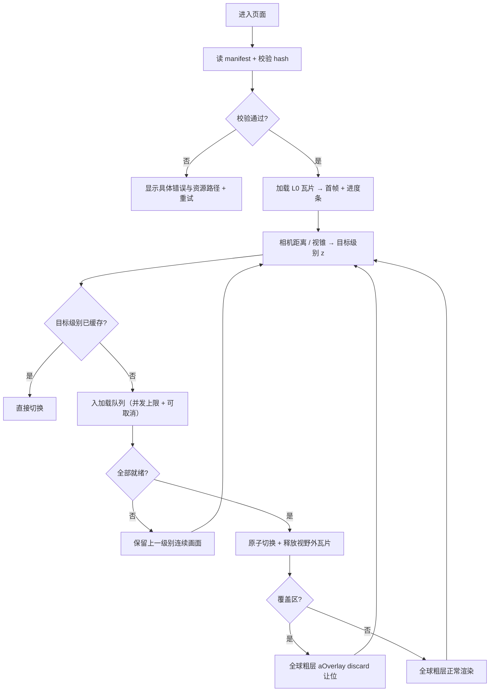
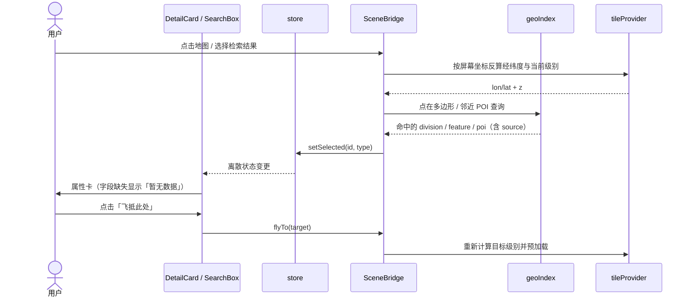
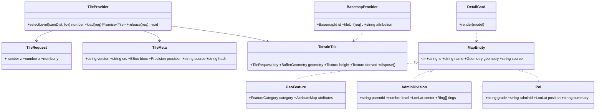

# 11 · 商业级地理体验系统设计

日期：2026-11-10。状态：**方案建议，待评审，未实施；本轮不修改业务代码**。
修订：v2（2026-11-10 评审后修订；问题清单与处理见 `13-方案文档评审记录.md`）；v3（同日，按「个人自用 / 非商业、允许境外底图」调整运行模式与底图策略，见 `13` 第八节）。

配套：`09-户外地理产品调研纪要.md`、`10-商业级地理体验需求说明.md`、`12-商业级地理体验验收方案.md`、`TASK/商业级地理体验迭代.md`。

> **证据边界**：本文所有架构、模块、字段、阈值均为**方案建议**，不是已验证结论，也不是用户已确认的范围。`10` 第五节 D1–D11 未拍板前，不得据此编码。文中标注【约束】的条目来自 `docs/02-开发规范.md`、`07`/`08` 的已验证修复、以及合规红线，任何方案都不得违反。

---

## 一、范围与硬约束

**目标**：在不推翻现有 React 工程的前提下，把「单张高度图 + 静态文字点」升级为「分块 LOD 地形 + 结构化地理数据 + 户外决策图层」，同时满足合规。

【约束】清单：

1. 正式项目继续是 **Vite + React 18 + TypeScript + R3F + zustand**；禁止 iframe / 原型 HTML 替代；禁止「首轮功能降级」条款。
2. 保留平面 / 地球双模式、全球地形、光照阴影、AO、导览、省份点选、夸张滑块、指北针、进度条与全部既有图层。
3. **覆盖区归属规则 `aOverlay` 必须保留**：全球粗层与亚洲精细层共面穿插曾导致近景泡状花斑（`07` 的根因），新瓦片方案须给出等价或更严格的让位判定，平面 / 球面共用。
4. 分层不倒挂：`data/` 不认识 React，`ui/` 不认识 three，`scene/` 两者可用；跨层只走 `state/store.ts`（离散状态）与 `scene/viewState.ts`（逐帧量）。
5. `src/pipeline/config.py` 是路径唯一来源；产物目录 `build/`、`app/public/data/`、`dist/` 禁止手改；每个脚本只写自己的产物。
6. 新增图层 / 标注必须同时：store 加键 → 面板加开关 → `tests/verify_build.py` 加断言。
7. **运行模式与合规**：设计 `personal`（个人自用、非公开、非商业）/ `public`（不特定人可访问）两种模式，**默认 `personal` 但必须非公开可访问**，否则按 `public` 处理。
   - `public`：底图仅腾讯 / 高德 / 百度 / 天地图；禁 Google / Apple / Bing 海外 / 直连海外 OSM / Mapbox / Leaflet+OSM；平面精度不优于 10 m、高程不优于 15 m、等高距 ≥ 20 m；审图号左下角、两年有效、每六个月新增标注备案。
   - `personal`：允许 Google / Apple / Bing / OSM / Mapbox / 天地图，但须遵守各厂商 ToS（Google 禁脱离 SDK 与缓存、Apple 不得脱离 MapKit、OSM 遵守 tile policy、Mapbox 受 token 与额度约束），且不得把可用 key 提交进仓库。
   - 两种模式都不放宽：**领土表达符合国家标准**、不标军事禁区与涉密实体、前端不硬编码可用 key、不得以「自用」为名对外发布。
8. 代码规范（`dev-workflow`）：Page-Hook-Component 分层、零 `any`、单文件 ≤200 行、函数 ≤30 行、单 Hook `useEffect` ≤2、页面级 Hook 命名 `use[PageName]Logic`、three 对象显式 `dispose()`。

---

## 二、总体架构



**设计取舍（建议）**：

| 决策 | 建议 | 理由 | 待拍板 |
|---|---|---|---|
| 渲染引擎 | **保留 R3F**，自建静态瓦片 LOD，不迁移 CesiumJS | 保住 `07`/`08` 已验证的渲染链路与完整能力；迁移等于重写球面、阴影、标注与修复证据 | D2 |
| 瓦片格式 | 自建 **heightmap 瓦片（16 位高程编码，沿用现有 R/G 编码）+ 二进制/JSON 索引**；不引入 Quantized-Mesh | 与现有解码一致，风险最小；代价是没有内置顶点法线，法线由离线派生层提供 | D2 |
| 底图服务 | 做成**可插拔适配器**，按模式给默认值：`public` → `tencent`；`personal` → `none`（本地晕渲，用户自选 OSM / Mapbox / Bing / 天地图）；无 key / 无服务时一律降级 `none` | 公开场景满足合规默认；自用场景不被 key 卡住，也不默认替用户选境外源 | D3、D9、D11 |
| 数据分发 | 全部静态文件 + 内容 hash，nginx / CDN 缓存 | 成本可控，沿用现有 CI 部署链路 | D8 |

---

## 三、数据资产设计（对应「数据库设计」）

【说明】本项目是**纯静态站点，无数据库、无服务端**。团队流程要求系统设计覆盖「数据库」，此处以**数据集 schema + 文件契约**作为等价输出件，**是否接受该等价形式需评审确认**（见第七节流程检查）。

### 3.1 文件契约

> 路径约定（按 `docs/02` 规则 1、3）：**源数据**放 `data/datasets/`（入库，人工校对）；**运行时产物**一律由管线写到 `app/public/data/`（不入库、禁手改），前端用 `BASE` 前缀取。下表「路径」列给源，产物路径为 `app/public/data/` + 同名相对路径。

| 文件 | 内容 | 关键字段 | 校验 |
|---|---|---|---|
| `app/public/data/tiles/manifest.json` | 瓦片金字塔索引 | `version`, `crs`, `scheme`, `bbox`, `tileSize`, `levels[]`（`z` / `resolution` / `tileCount`）, `encoding`, `source`, `precision`, `hash` | 与 `tests/verify_build.py` 双向断言；版本不匹配时整批失效 |
| `app/public/data/tiles/{z}/{x}/{y}.webp` | 无损 16 位高程瓦片（R/G=高程，B=水深/标记） | — | 无损编码，禁止有损（有损会翻转境内/境外判定，见 `prep_world.py` 注释） |
| `app/public/data/derived/{z}/{x}/{y}_{layer}.webp` | 派生专题层：`hillshade` / `slope` / `aspect` / `contour` | — | 与对应高程瓦片同网格、同范围、同 `z` |
| `data/datasets/cities.json` | 省 / 市行政单元（**沿用现名扩字段，不改名**） | `id`（新增）, `name`, `parentId`（新增）, `level`（新增）, `center`, `rings`, `source`（新增） | 完整性：34 个省级行政区齐全（现缺台湾省、澳门特别行政区） |
| `data/datasets/geo-features.json` | 山峰 / 山脉 / 河流 / 湖泊 | `id`, `name`, `category`, `geometry`, `elevation?`, `prominence?`, `range?`, `basin?`, `source` | 属性缺失写 `null`，禁止臆造 |
| `data/datasets/poi.json` | 景区 / 名胜 | `id`, `name`, `category`, `grade`, `lon`, `lat`, `adminId`, `summary`, `source` | 不含私人位置数据 |
| `data/datasets/search-index.json` | 检索索引（静态构建） | `term`, `type`, `targetId` | 与上述三个数据集逐条对齐 |

### 3.2 精度与坐标系契约

- **问题定义（评审修订）**：栅格底图瓦片是「按瓦片索引预先切片」的，**无法在请求时做逐点坐标转换**；若地形 / 矢量用 WGS-84、底图用 GCJ-02，整幅画面会整体偏移数百米，且偏移随位置变化，标注与地形必然错位。因此必须**整场景统一到一个坐标系**，而不是「按请求转换」。
- **可选方案（D9）**：

  | 方案 | 做法 | 代价 | 评价 |
  |---|---|---|---|
  | A. WGS-84 系底图（OSM / Mapbox / Bing / 天地图） | 地形、矢量、标注保持 WGS-84，不偏移 | 需确认各源 ToS 与国内可达性 | **自用推荐**：与现有地形同系、零重采样 |
  | B. 全场景转 GCJ-02 | 构建期把高程瓦片重采样、矢量与标注全部转换到 GCJ-02 网格 | 需重采样、精度损失、每级瓦片都要转 | 仅在必须用腾讯 / 高德底图时采用 |
  | C. 不接底图 | 只用本地晕渲 + 分层设色 | 无影像真实感 | 作为默认回退路径 |

  > Google / Apple 虽属 WGS-84 系，但瓦片不得脱离其 SDK 使用、禁止缓存，**不建议接入自研引擎**；`public` 模式下 A 只保留天地图。

- **规则**：
  1. 禁止在运行时对栅格瓦片做「逐请求坐标转换」；坐标转换只能发生在构建期，或选择同坐标系底图。
  2. 同一场景内只允许一个坐标系；`manifest.crs` 必须显式声明，CI 校验。
  3. 接入底图前用至少 5 个已知地标做偏移抽检，偏差阈值写入 `12` 的 TC-04。
- **精度声明**：`manifest.json` 的 `precision` 字段记录来源与标称精度；**公开发布版**遵循平面不优于 10 m、高程不优于 15 m、等高距 ≥ 20 m；**个人自用版**不受该上限约束，但须标注来源与实际精度，且不得使用涉密测绘成果；任何超出声明精度的数据不得进入 `app/public/data/`。
- **来源可追溯**：每个数据集必须带 `source`（名称 + 版本 / 发布日期 + 授权或依据），CI 校验缺失即失败。

### 3.3 瓦片方案参数（评审补全）

评审发现原稿只说「z0..zN」而未定义方案，无法实施也无法验收。以下为**建议参数**，随 D2 一并确认。

| 参数 | 建议值 | 说明 |
|---|---|---|
| 投影 | **Web Mercator（EPSG:3857）** 切瓦片；平面场景反投影到经纬度网格 | 与现有 `prep_data.py` 的 Mercator 取瓦片一致；球面直接用经纬度 |
| 瓦片尺寸 | 256×256 px | 与现有 Terrarium 瓦片一致，便于对照 |
| 级别范围 | `z0–z8`（全球）＋中国区加密到 `z10` | z8 约 0.7°（赤道 ≈78 km/瓦片，单像素 ≈300 m）；中国区 z10 单像素约 75 m。**具体级别按 D2 与合规精度上限最终确认** |
| 覆盖 | 全球 `z0–z4`（回退层）＋亚洲 `z5–z8`＋中国 `z9–z10` | 保留「全亚洲渲染」范围（受 D10 约束） |
| 编码 | 无损 WebP，R/G 为 16 位高程（沿用现解码），B 为水深 / 标志位 | 有损会翻转境内 / 境外判定，禁止 |
| 命名 | `tiles/{z}/{x}/{y}.webp`，内容 hash 写入 manifest 而非文件名 | 便于整批失效与缓存策略 |
| 缓存 | `Cache-Control: immutable` + manifest 版本控制；版本变更时清空旧级别 | 避免旧瓦片与新 manifest 混用 |
| 切级 | 距离阈值 + 迟滞（hysteresis）0.15，避免临界抖动 | 防止反复加载 / 释放 |
| 并发 | 同时最多 6 个瓦片请求，可取消 | 慢网下不抢占首帧 |
| 单瓦片体积 | ≤ 256 KB | 见 §九 |

> 【风险提示】上表级别对应的地面分辨率只是**几何分辨率**，不代表产品可发布精度；发布精度仍受 10 m / 15 m 上限约束（§3.2）。

### 3.4 数据构建流程



> 【约束】`gdaldem hillshade` 类派生层按 `09` §3.1 的社区经验设置方位角 / 高度角 / `-z` / `-s`，并使用多方向合成与金字塔；垂直夸张**只作用于显示**，派生层与坡度数值一律基于真实高程计算。

---

## 四、接口契约（对应「API 设计」）

【说明】本项目**无服务端 API**（无账号、无数据库、无用户数据回传），该输出件标注为**不适用**，理由如上；需评审确认是否接受。存在的是以下三类契约：

| 契约 | 方向 | 形式 | 失败处理 |
|---|---|---|---|
| 静态瓦片 / 数据集 | 构建产物 → 前端 | `fetch(BASE + 'tiles/...')`，文件名带内容 hash | 404 / 解码失败 → 保留上一级别 + 明确错误（禁止只报 `Failed to fetch`） |
| 底图服务（按模式） | 前端 → 允许的底图服务 | 适配器 `BasemapProvider`；`public` 仅白名单，`personal` 可扩展；key 按厂商规范配置，不进仓库 | 无 key / 配额 / 鉴权 / 网络失败 → 降级本地晕渲，不白屏 |
| 调试与回归钩子 | 浏览器 → `window.__ta` | 沿用 `camAt / view / step / sun / info / pick / cam / probeLayers`，新增 `tiles()`（当前级别与加载状态） | 仅开发 / 回归使用 |

`BasemapProvider` 接口（建议，零 `any`）：

```ts
export interface BasemapTileRequest { z: number; x: number; y: number; }

/** personal 允许境外源；public 仅白名单 */
export type RuntimeMode = 'personal' | 'public';
export type BasemapId =
  | 'tencent' | 'amap' | 'baidu' | 'tianditu'
  | 'google' | 'apple' | 'bing' | 'osm' | 'mapbox'
  | 'none';

/** public 默认腾讯；personal 默认 none（用户自选），无 key / 无网均降级 none */
export const DEFAULT_BASEMAP_BY_MODE: Record<RuntimeMode, BasemapId> = {
  public: 'tencent',
  personal: 'none',
};

export interface BasemapProvider {
  readonly id: BasemapId;
  readonly modes: readonly RuntimeMode[];
  tileUrl(req: BasemapTileRequest): string | null;
  readonly attribution: string;
  readonly termsUrl: string;
}
```

> 评审修订（v2）：原稿默认值写成 `none`，与公开场景「未指定时默认腾讯地图」冲突 → 改为按模式取默认。
> 评审修订（v3）：用户明确「个人自用、非商业」后，`personal` 模式放开境外源；但**Google / Apple 的瓦片不得脱离其 SDK、不得缓存**，`BasemapProvider` 里保留 `modes` 与 `termsUrl` 是为了在 UI 侧明确「这一源能用在哪、受什么约束」。`public` 模式下，非白名单源即使配置了也必须拒绝加载。

---

## 五、模块划分与影响范围

| 层 | 模块 | 状态 | 职责 | 约束 |
|---|---|---|---|---|
| 管线 | `prep_tiles.py` / `prep_derivatives.py` / `prep_geo.py` / `publish_tiles.py` / `verify_compliance.py` | 新增 | 瓦片、派生层、矢量与索引、产物发布、合规校验 | 路径全部取自 `config.py`；只写自己的产物 |
| 管线 | `prep_data.py` / `prep_world.py` | 保留 / 调整 | 保留现有全场高度图作为 L0 与回退基线 | 不得就地覆盖输入 |
| 数据 | `data/tileProvider.ts` | 新增 | 级别计算、视锥裁剪、加载队列、缓存与释放 | 不认识 React |
| 数据 | `data/geoIndex.ts` / `data/poiTypes.ts` / `data/coords.ts` | 新增 | 要素索引、类型定义、坐标转换 | 显式 interface，零 `any` |
| 场景 | `scene/TerrainTiles.tsx` | 新增（与 `TerrainMesh` 共存过渡） | 分块网格装配、级别切换、`aOverlay` 归属判定 | 一个组件一族 three 对象；`dispose()` 完备 |
| 场景 | `scene/DerivedLayers.tsx` / `scene/PoiLayer.tsx` | 新增 | 专题层混合、POI 图标与点选 | 逐帧量走 `viewState` |
| 场景 | `scene/VectorLayers.tsx` / `FlowLayers.tsx` / `LabelLayer.tsx` / `terrainMaterial.ts` | 修改 | 市界改为独立图层、真实水系 / 路网、LOD 避让、色带与晕渲混合 | 保留现有全部开关（`SidePanel` 实测 **15** 个：8 个图层 + 7 个标注组；store 另有 `x` / `rl` / `rd` 三组未暴露）与既有交互 |
| 状态 | `state/store.ts` | 修改 | 新增 `basemap`、`derived`、`poi`、`divisions` 等离散键 | 逐帧量**不进** store |
| UI | `ui/SearchBox.tsx` / `ui/DetailCard.tsx` / `ui/ComplianceFooter.tsx` | 新增 | 检索、详情、审图号与免责声明 | 不 import three |
| UI | `ui/SidePanel.tsx` / `ui/Chrome.tsx` | 修改 | 新开关、图例联动、左下角合规位 | 沿用 `05` 的信息架构 |
| 验证 | `tests/verify_build.py` / `scripts/diag-baseline.js` | 修改 | 新产物断言、合规断言、同机位证据 | 固定提交 / hash / 视口 / 机位 / 光照 |

---

## 六、主要流程

### 6.1 启动与 LOD 加载



**从单网格到分块的切换与回退（评审补全）**：

1. **共存期**：`TerrainMesh`（现有单网格）保留为 `L0/fallback`，`TerrainTiles` 以开关 `tiles` 逐步接管；两者不得同时绘制同一区域，避免再次出现共面穿插。
2. **切换判定**：`manifest` 校验通过且当前级别瓦片全部就绪 → 原子替换；任一条件不满足 → 留在单网格，界面不提示错误。
3. **回退**：瓦片连续失败 3 次 / 解码异常 → 自动回退单网格并记录原因；用户可在「画面」面板手动锁定「兼容模式」。
4. **验收**：回退路径本身要测（TC-18），不能只测正常路径。

### 6.2 点选要素并查看详情（序列图）



### 6.3 类图（核心类型，建议）



---

## 七、细腻度与渲染方案要点（建议）

1. **几何**：分块网格按级别细化；相邻级别边缘使用裙边（skirt）或共享边界顶点，避免裂缝；`aOverlay` 让位判定改为「按瓦片自身网格反解经纬度 + 与亚洲覆盖矩形比较 + 内缩 0.5° 过渡带」，平面 / 球面共用。
2. **法线与光照**：法线由派生层提供（不依赖单一粗网格平滑）；多方向晕渲与太阳实时阴影叠加，避免 `-z` 过大导致的「麻面」（`09` §3.1）；阴影门限沿用 `shadowGate` 思路但需重新标定。
3. **色彩与专题**：分层设色连续过渡；坡度角 / 坡向 / 等高线作为可叠加的半透明层；图例与当前可见图层联动。
4. **垂直夸张**：**默认 5×**（源码 `DEFAULT_EXAG = 5`，`docs/01` 的 8.5× 已过期），是否随缩放级别自适应需评审；**所有派生数值基于真实高程**，夸张只改显示。
5. **标注**：四级 LOD + 屏幕空间避让保留；新增 POI 聚合与优先级队列；面板折叠时同步解除裁切。
6. **防回归**：每层新增后，用 `scripts/diag-baseline.js` 在**真实 GPU** 下按 rAF 帧计数等待截图；headless SwiftShader 实测仅 1 fps，固定 `waitForTimeout` 会截到滞后帧，不得作为证据。放大问题机位固定 `dist=18~25`；另测球面与 `dist=55` 全景。

---

## 八、任务拆分计划（垂直切片，待评审）

> 每个切片独立开发、独立自检、独立 MR、独立可验收；MR 必须包含任务描述，禁止几千行超大 MR（`development-process-check`）。**以下仅是计划，评审通过后才会执行。**

| 切片 | 期 | 内容 | 独立验收 |
|---|---|---|---|
| S1 | P0 | 合规基线：数据源清单、审图号位、免责声明、`verify_compliance.py` | 精度 / 来源 / 领土完整性断言通过 |
| S2 | P0 | `manifest.json` + 瓦片索引 + `tileProvider` 纯逻辑（无 UI） | 单元测试：级别计算、视锥裁剪、缓存释放 |
| S3 | P0 | `prep_tiles.py` 产出 **z0–z4 全球回退层 + 亚洲 z5–z8**，与 L0 单网格兼容 | 产物 hash 与回归截图一致；`manifest.crs/levels` 断言通过 |
| S4 | P0 | `TerrainTiles` 接入平面模式，保留 `aOverlay`，实现共存 / 切换 / 回退 | 近景 `dist=18~25` 无泡状花斑 / 空洞 / 裂缝；回退路径可用 |
| S5 | P0 | 球面模式同规则接入 + `07`/`08` 全能力回归 | 球面完整、无空洞、缩放连续 |
| S6 | P0 | `prep_derivatives.py` 晕渲 / 坡度 / 等高线 + 图例联动 | 三视图切换正确，等高距 ≥20 m |
| S7 | P0（数据）/ P1（交互） | 行政区划数据补齐（含台湾省、澳门特别行政区）；市级图层独立开关与浏览 | 34 省级齐全；446+ 市级可浏览；缺数据省份不静默跳过 |
| S8 | P1 | 结构化山河 + 景区 POI + `DetailCard` | 属性有来源，缺失显示「暂无数据」 |
| S9 | P2 | `SearchBox` + 飞抵 + 高程剖面 / GPX 预览 | 检索与跳转可用，免责声明在位；剖面基于真实高程 |
| S10 | P2 | 性能精修、线上一致性、文档同步与评审签署 | 全部 TC 通过，线上与本地产物逐文件一致 |

---

## 九、性能预算（建议值，待 D8 确认）

| 指标 | 建议阈值 | 基线 / 依据 |
|---|---|---|
| 首屏静态数据体积 | **≤ 3.5 MB**（不劣于现状） | 现状约 3.5 MB |
| 单块瓦片 | ≤ 256 KB，带内容 hash | 便于缓存与增量更新 |
| 首帧时间 | ≤ 4 s（10 Mbps、桌面浏览器） | 现状进度条显示约 2.1 MB 下载 |
| 稳定帧率 | ≥ 30 fps（中端集显） | `08` 实测 AMD Radeon 780M 39 fps |
| JS 内存 | ≤ 400 MB | `09` §3.1 社区参考 180–360 MB |
| LOD 切换 | 无白屏、无闪回、无重复下载 | 用户多次反馈「放大后脱节」 |
| 线上一致性 | 产物逐文件 hash 可比对 | `03-部署运维.md` 的发布链路 |

**测量口径（评审补全）**：首屏体积 = 首帧前全部网络响应 body 之和（含 `manifest` 与 hash 校验请求）；首帧时间 = `navigationStart` → 首个 rAF；帧率 = 连续 60 帧平均；内存 = 稳定 10 s 后 `performance.memory.usedJSHeapSize` 采样；瓦片命中率 = 缓存命中数 ÷ 请求总数；重复下载 = 同一 `(z, x, y, version)` 在单次会话内被请求超过 1 次的次数。**全部须在真实 GPU 下测量，headless SwiftShader 数值不作证据。**

---

## 十、风险与合规清单

| 风险 | 说明 | 缓解 / 责任 |
|---|---|---|
| **境外高程源（按模式）** | `personal` 可沿用 Terrarium；`public` 不在白名单 | D4 按模式处置；`public` 未替换前不上线；界面标注来源与精度 |
| **「全亚洲」范围与精度** | `personal` 可保留全球 Terrarium；`public` 境外来源与精度未定，可能只能保留示意层 | D10；界面明确「示意 / 实测」标注，不得暗示高精度 |
| **瓦片版本混用** | 新 `manifest` 与旧缓存瓦片同时存在会导致高程跳变 / 接缝 | `version` 变更时整批失效；`Cache-Control: immutable` + 版本目录 |
| **超精度内容** | 高精度 DEM / 影像可能触碰 10 m / 15 m 上限 | `manifest.precision` + CI 断言 + 人工复核 |
| **行政区划缺失** | `cities.json` 缺台湾省、澳门特别行政区 | S7 按国家标准地图补齐，验收逐项核对 |
| **审图号 / 备案（仅 public）** | 公开发布的互联网地图服务需左下角审图号、两年有效、六个月备案 | D5；`public` 由项目方办理；`personal` 以「非公开可访问」为前提，不办理但不得对外发布 |
| **「自用」变公开** | 站点仍在公网 8159 监听，任何人可访问，事实上构成公开地图服务 | D11：下线 / 内网 / 加鉴权；`personal` 模式启动时检测可访问性并提示 |
| **底图 ToS 违规** | Google 禁止脱离 SDK 使用瓦片与缓存；Apple 瓦片不得脱离 MapKit；OSM 有 tile usage policy；Mapbox 受 token / 额度约束 | 适配器标注 `termsUrl` 与 `modes`；不做批量下载 / 离线打包；Google / Apple 不接入自研引擎 |
| **底图可达性** | Google 国内不可达；OSM 公共瓦片慢且限速；Mapbox / Bing 需网络条件 | 默认 `none` 本地晕渲；失败自动降级；文档标注各源可达性 |
| **key 泄露 / 配额** | 前端明文 key 可被嗅探；官方 key 有 Referer / 额度限制 | key 不入仓库（`.env.local` / 本地配置）；按官方规范配置 Referer；额度耗尽降级 |
| **坐标偏移** | WGS-84 与 GCJ-02 / BD-09 混用导致标注错位 | 同一场景单坐标系；`manifest.crs` 显式声明；5 地标抽检 |
| **渲染回归** | 新瓦片可能让 `07`/`08` 修复的共面穿插复发 | 保留 `aOverlay`，每切片跑真实 GPU 基线 |
| **内容准确性** | 山峰海拔 / 景区等级 / 水系走向若无权威来源会误导 | 每条数据带 `source`；缺失写 `null`；禁止臆造 |
| **安全责任** | 坡度 / 地形判断可能被误用于安全决策 | 显著免责声明，不承诺导航 / 救援 |
| **成本失控** | 云厂商按 session / request 双计量 | 静态瓦片 + CDN；离线优先 |
| **范围膨胀** | 商业级目标容易被理解为一次做完 | D6 分期；每期独立验收 |

---

## 十一、流程检查结论（按 `development-process-check`）

- **阶段**：系统设计（新特性）。
- **已完成**：系统设计文档，覆盖「数据库」→ 第三节数据集 schema + 文件契约（**等价形式，需评审确认是否接受**）；「API」→ 第四节 **明确标注不适用**（纯静态站点，无服务端 API），并给出静态产物 / 底图适配器 / 调试钩子三类契约；模块划分（第五节）；主要流程 + 流程图 + 序列图 + 类图（第六节）；任务拆分计划（第八节）。
- **缺失 / 阻塞**：
  1. **评审人 / 评审结果**：2026-11-10 已由助手完成两轮自动复核（v2 代码/数据复核、v3 自用模式修订，见 `13-方案文档评审记录.md`），但**用户确认与评审人签署仍缺**，按规范不得视为评审完成。
  2. **特性设计文档**：属开发阶段输出件，尚未进入该阶段，不得提前声称完成。
  3. **「数据库 / API」两项以等价形式或「不适用」处理**，是否认可需评审明确表态；规范明确要求缺任一部分都要指出，不得用「系统设计已完成」概括通过。
  4. D1–D11 共 11 项决策未拍板（新增 D9 坐标系、D10 境外覆盖、D11 公网访问处置）。
- **下一步**：用户审核并指定评审人 → 记录评审结论 → 决策 D1–D11 → 进入开发阶段并先产出特性设计文档。
- **结论**：**可提交评审，不可开始编码**。
